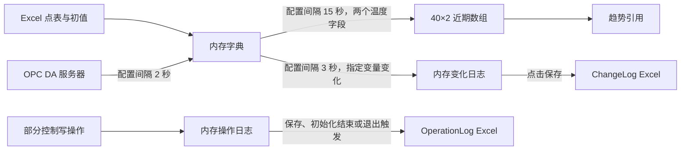

# 需求与实现审核：旧 C#、当前 Java、甲方补充信息

日期：2026-10-29。审核对象为本机当前源码和配置，不代表 GitHub 上已发布的状态。

后续实现说明：本报告保留审核时的快照。其后已按操作者授权增加本次运行内凭据复用、点位浏览/选择与增量保存，详见 README 和 VERIFICATION。定时采集、近期窗口及 Excel 存储仍未实现；不能以新增浏览功能替代这些数据层需求。

2026-10-30 第一部分更新：现已补齐桌面首次配置准备、证书初始化/复用与公开证书导出入口、值/质量/时间读取表、点位写授权与范围编辑、总开关、一次写入及回读。真实 UI 已完成本机登录、按设备选点保存、读取、sim从42写为43及独立Quick Client核对；89项自动测试通过。下文表格是10月29日的历史审核，当前操作与边界以 README、UI_TEST、VERIFICATION 为准。服务器用户创建及证书信任批准仍在KEP工具中完成；生产配置一致性、远程和国产系统验收没有因此完成。

本轮只读审查源码、配置、现有工作簿结构及已有验证记录；本文件是唯一新增的审核产物。没有修改应用代码、账号、证书、KEP 工程或写入开关，没有重新联机、读写点位或重跑测试。旧程序与 Java 分别进行了独立复核。

## 1. 结论与范围

最初会议要求是：Java 替换底层连接/读取/写入，先跑通通信，再叠加桌面可视化与分析；服务器参数通过配置文件管理，并处理安全策略和证书。

当前 Java 已完成本机通信验证及服务器连接桌面界面。此前“仅做服务器页面”的限定已经满足，但整个旧业务程序尚未完整迁移。

本次甲方补充明确了另一条数据需求：定时读取指定地址，持续更新用于近段时间计算的内存数据，并使用 Excel 保存相关数据。当前 Java 尚未实现定时采集、近期缓存和 Excel 存储，应作为后续数据层任务，不能将一次读取的结果列表视为完成了近期数组。

旧 C# 的实际实现与“把采集数组存 Excel”的概括并不完全相同：近期数组在内存；Excel 用于输入点表/初值，以及输出变化/操作日志。没有找到将完整近期数组定时导出到 Excel 的调用。应向甲方确认希望继承的具体 Excel 格式与保存内容。

## 2. 需求对照

| 需求 | 旧 C# 事实 | 当前 Java 事实 | 审核判断 |
| --- | --- | --- | --- |
| 跨平台 Java 客户端 | .NET Framework、WinForms、OPC DA.NET | Java 21、Swing、Eclipse Milo；桌面没有旧 DLL/COM 依赖 | 实现方向符合，国产系统与 CPU 架构未实测 |
| 建立服务器连接 | OPC DA 服务器枚举与连接 | 指定发现地址查询 UA 端点、建立认证会话、显式断开 | 本机 UA 会话已验证；不是逐行移植 DA API |
| 读取指定地址 | Excel 点表驱动，每 2 秒逐点同步读取 | 属性点表驱动，支持单次/批量读取、状态码及时间戳 | 底层接口已具备；连续采集未实现 |
| 写入指定地址 | DA 写入，部分定时器自动写工艺点 | 类型/量程/权限检查、单次写及回读确认 | 本机静态模拟点有历史验证；远程/生产写仍受代码限制 |
| 桌面 UI | 服务器、读取、保存、启动、升降温等 | 服务器查询、连接、断开、退出 | 符合当前仅做服务器页面的范围 |
| 核心参数配置管理 | 地址点表外置，但服务器快捷连接、部分动作地址及周期写在代码中 | 地址、发现地址、策略、身份、超时、PKI、点表均外置 | 已有基础；仍存在模式/写入环境硬限制；采集/存储参数尚无实现 |
| 安全策略与证书 | 交付代码走 OPC DA；没有本 Java 流程的 UA 应用证书处理 | PKCS12 身份、公开证书、strict/first-use 信任与用户认证 | 已处理本机连接；现场策略/信任制度未获得 |
| 模拟器与生产一致 | 附带多个点表版本，不能直接认定为现场权威表 | 已验证本机 KEP 模拟点 | 没有现场工程、点位及策略基线，不能宣称已一致 |
| 定时采集 | 2 秒采集当前值 | 未实现应用层周期采集 | 需补数据层；Milo 保活不是点位采集 |
| 近期数组/窗口 | 两个温度字段，40×2 数组，15 秒更新 | 未实现通用近期历史缓存 | 本次新增需求的主要缺口 |
| Excel 输入/存储 | 配置/初值输入，变化/操作日志输出 | 没有 Excel 导入、导出或写盘模块/依赖 | 先确认保存语义，再实现 .xlsx 数据层 |
| 全量工艺/算法/图表迁移 | 有部分流程代码；历史数组用于趋势引用 | 未实现 | 不属于本次服务器窗口任务，不据本轮信息直接扩展 |

证据入口：[旧 Form1.cs](../裂解炉2/裂解炉2/Form1.cs)、[旧定时器设置](../裂解炉2/裂解炉2/Form1.Designer.cs)、[Java 配置](src/main/java/cn/buct/ua/ClientSettings.java)、[Java 通信](src/main/java/cn/buct/ua/UaConnection.java)、[依赖声明](pom.xml)、[已有验证记录](VERIFICATION.md)。

## 3. 旧 C# 数据的实际流向

### 3.1 采集与近期窗口

- `Form1.cs:79–83`：加载三份 Excel；`itemDictionary` 保存变量别名到 DA ItemId 的映射，`Data` 保存最近一次成功读到的数值。
- `Form1.Designer.cs:122`、`Form1.cs:155–170`：每 2000ms 遍历点表，将返回值转为 double，覆盖 `Data[alias]`。来源是 `OPC_DS_CACHE`。
- `Form1.Designer.cs:147`、`Form1.cs:328–345`：每 15000ms 取 `TIC06000A`、`TIC06000A_SP` 两个当前值，移位写入 `PvSp_Test[40,2]`。
- 该数组名义容量约 10 分钟；40 个真实且均匀样本的首尾时间跨度是 39×15=585 秒。它不保留所有 2 秒读取结果。
- 首次更新把同一次当前值填入全部 40 行，不能把这些位置视为 40 个真实历史样本。没有逐样本时间戳、质量码或有效样本数。
- 当前交付源码中，该数组的读取用途是趋势绘制；`V_TAG` 等控制分支使用当前 `Data`。没有证据表明完整的近期窗口计算算法已在这份源码中交付。
- 定时器是 WinForms UI 定时器；同步读与 Excel I/O 会占用 UI 线程。这里的 2 秒/15 秒是设置值，不是实测严格周期。

### 3.2 Excel 的三类用途

| 文件/类别 | 实际用途 | 证据 |
| --- | --- | --- |
| `itemDictionary.xlsx` | 输入变量别名和 DA 地址，前两列逐行载入；不是历史数据文件 | `Form1.cs:79,222–232` |
| `opsDictionary.xlsx` | 指定需监视变化的变量及起始数值 | `Form1.cs:80–81,236–245` |
| `初始化点火.xlsx` | 初始化动作所用地址输入 | `Form1.cs:83,250–261` |
| `ChangeLog_*.xlsx` | 变量名、旧值、新值、本机时间；点击保存才写出，成功后清空变化列表 | `Form1.cs:265–325` |
| `Logs/*OperationLog*.xlsx` | 部分控制操作的时间、名称、地址、旧值、新值；保存/初始化结束/退出触发写出 | `Form1.cs:405–517,591–593` |

没有找到 `PvSp_Test` 的完整 Excel 导出。也没有“定时将所有点位的每次采样写入 Excel”的逻辑。现有 x86 输出目录的 `ChangeLog_20261029121846.xlsx` 只有表头；文件存在不能证明其中已有有效采样记录。

### 3.3 旧版行为中不应直接继承的内容

1. **读取失败仍显示成功**：`Form1.cs:159–170` 吞掉异常并无条件显示成功，失败点可继续保留旧值；没有校验 OPC 质量和源时间。
2. **读取附带写操作**：`Form1.cs:207–219` 在读取后启动看门狗，后者会写 MODEATTR、MODE、OP；不能把原“数据读取”按钮整体当作独立只读采集模块迁移。
3. **伪历史填充**：首轮复制 40 个相同值，应使用有效样本数及明确的窗口就绪状态，避免计算把初始化填充当作真实历史。
4. **日志可靠性问题**：变化日志与操作日志列表没有容量边界；退出只处理 `ExcelLogger`，没有将未保存的 `changeLogs` 写出。已有操作日志追加从最后已用行开始，可能覆盖原末行（`Form1.cs:457–479`）。
5. **断开没有停定时器**：`Form1.cs:141–148` 仅断开服务器，未停止采集/控制定时器；新采集器需要明确开始、停止、断开和退出行为。
6. **旧点表不唯一**：`bin/Debug/itemDictionary.xlsx` 有 14 个别名，`bin/x86/Debug/itemDictionary.xlsx` 有 8 个；x86 版缺少源码看门狗使用的 `FC1133AOP` 等别名。不能把任一附带表直接视为完整生产基线。

这些是源码/文件静态审查结果，本轮没有启动旧控制流程来验证其运行后果，也没有修改旧代码。

## 4. 当前 Java 已有能力与明确限制

### 4.1 可继续复用的部分

- `ClientSettings.load`（160 行起）：读取配置并按配置文件目录解析 PKI/点表相对路径。
- `UaConnection.readValues`（227 行起）：一次批量读取，返回别名、NodeId 和含值/质量/时间戳的 DataValue；适合给后续采集器复用。
- `UaConnection.write`（263 行起）：显式写入检查与回读；不自动重放未知结果的写入。
- `LocalPki`：初始化和加载持久身份、导出 `client.der`、人工核对公开证书指纹。
- `ServerTrust`：strict 人工预置信任，或 first-use 首次记录并校验后续同一端点的证书。
- 桌面 `ServerConnectDialog`/`ServerWindow`：网络工作在后台执行；连接建立后持有会话，断开时释放。

`readValues` 会保留非 Good 结果，不能直接把整个返回列表当成有效计算输入；未来采集器仍需处理坏质量、读取失败、陈旧值和缺测。

### 4.2 不能说成“任意现场只改配置即可”

- `ClientSettings.java:43–44` 强制非 None 策略，且模式只能 SignAndEncrypt。即使文件中写 Sign 或 None，当前版本也会拒绝。现场如要求这些组合，需要评估后适配代码；不应为迁就本客户端而擅自修改现场服务器策略。
- `ClientSettings.java:46–50` 只支持 username/anonymous。应用实例证书已经支持，但 X509 用户身份登录不是同一功能，目前没有实现。
- `ClientSettings.java:220–234` 写入仅接受 simulation + 本机回环 + 点位允许 + 显式确认等条件。远程读取/连接可配置，不等于远程写入已开放。
- 桌面表单只影响当前连接，不写回配置；所选端点可临时覆盖安全策略，但仍经过上述模式/身份检查。
- 主窗口“会话已建立”是最近一次建立会话的结果，不是持续在线监测；尚未把断线/恢复状态接到 UI。

因此，“关键参数已外置”成立；“已经支持全部现场组合”不成立。此前若将两者混为一谈，应以本次审核的明确边界为准。

### 4.3 当前写入开关事实

| 位置 | 本轮读取值/行为 |
| --- | --- |
| `config/local/client.properties` | `writes.enabled=false` |
| `config/local/write-test.properties` | `writes.enabled=true` |
| `config/local/nodes.properties` | `simValue.writable=true` |
| `DesktopEndpoint.java:77` | 桌面连接强制 `writesEnabled=false` |

不能称当前所有本机配置都禁写。独立写测试配置已开启，但仍受本机模拟写门禁限制；本轮保留操作者的配置原状。

## 5. 本次截图与当前项目的对应关系

- “模拟标签、UA 地址、安全策略、账号权限、双方证书信任”与现有联调流程方向一致；它们是联机准备，不代表生产配置已获得。
- 截图中的 `SimChannel / SimDevice / JavaTest / K1000 / Float` 是示例。当前已验证点是另一套名称与 UInt16 类型，应以实际 Browse、DataType 和点表为准，不因示例而改名或改类型。
- Simulator 驱动内部地址（如 K 寄存器）与 Java 使用的 UA NodeId 分属不同层，不能将 K1000 直接填成 NodeId。
- 截图关闭匿名、使用测试账号，是该示例的选择；生产身份方式仍需确认。写权限需同时满足标签属性及服务器账号/用户组授权，客户端配置不能代替服务器授权。
- 截图中的 `D:\Java\Project\UA\runtime\security\...` 属于另一套项目布局。当前导给 KEPServerEX 的公开应用证书是本项目 `pki/client.der`；不是截图中的旧路径，也不是 `.p12` 私钥库。
- 当前 strict 模式使用配置 PKI 目录下的 `trust-store`；first-use 使用 `server-pins` 按端点记录公开证书。两者均保留服务器属性校验。first-use 不等于删除客户端对服务器的信任检查，首次来源确认仍依赖操作者确认的地址与网络。
- 当前本机 Basic256 是兼容测试配置。PTC 文档说明 Basic128Rsa15/Basic256 已被弃用；不能把本机配置默认认定为生产推荐值，应按现场实际及双方确认的安全要求选择支持组合。

官方资料用于核对通用机制，不代替甲方现场参数：

- [PTC OPC UA 配置教程：端点与证书交换](https://support.ptc.com/help/kepware/features/en/kepware/features/OPCUACONFIGMNGR/quick-start-tutorial.html)
- [PTC User Manager：用户组控制项目访问](https://support.ptc.com/help/kepware/kepware_server/en/kepware/server/user-manager.html)
- [PTC OPC UA Configuration Manager 手册：策略和兼容性说明](https://community.ptc.com/sejnu66972/attachments/sejnu66972/kepware/2477/2/Kepware_OPC-UA-Configuration-Manager-Manual.pdf)

## 6. 建议补充顺序

优先补充独立的数据链路，不重写现有 UA 层，也不据此加入启动、升降温或工艺自动写入：

`已有 UaConnection → 周期 readValues → 带质量/时间的近期缓存 → 计算消费者 → Excel 保存`

1. **明确输入点表**：确认需采集哪些点、真实 UA namespace URI/identifier、类型、单位、读写属性。保留现有属性配置入口；若甲方仍以 Excel 交付点表，可增加导入转换，不能自动将 DA ItemId 等同于 UA NodeId。
2. **实现周期采集**：可配置周期，后台执行，避免上轮未结束就叠加下一轮；复用 `readValues` 和现有会话，停止/断开时结束采集。
3. **实现有界近期缓存**：每个点保留时间、值、质量和有效样本数量；明确容量/时间窗口、缺测与过期规则，不用重复初值伪造窗口已就绪。
4. **实现 Excel 保存**：确认是全量采样、仅变化、操作日志还是窗口快照。规定列、刷盘触发、文件拆分、文件占用/磁盘失败处理及退出保存。存储工作放后台，不能阻塞采集和 UI。
5. **完善部署适配与验收**：根据现场策略/身份组合评估支持范围，完成双机连接/读取、长期采集与停机保存测试，最后在目标国产 OS/架构上验收。

采集周期、入窗周期、窗口容量、Excel 目录及刷盘/分割规则都应外置。但这些采集/存储配置键当前没有对应模块；只向 properties 加几行不会让功能自动出现。2 秒/15 秒/40 点仅可作为旧代码对照，未经确认不能定为正式生产指标。

建议数据验收至少包含：动态模拟值连续进入缓存、达到容量后淘汰最旧样本、断线后不把旧值当新值、重新连接的缺口可识别、Excel 行数/时间/值与保存语义一致、正常停止/退出后应保存内容齐全。

## 7. 最少需要甲方确认的信息

| 问题 | 原因 |
| --- | --- |
| 现场 endpoint/发现地址、主机/端口、策略、模式、身份方式、账号权限和证书制度 | 决定现有连接代码是否直接适配，以及需要补哪些组合 |
| 权威点表及 Excel 示例 | 旧输出目录点表不同；DA 地址不能直接当 UA NodeId |
| 哪些点进入近期数组，采集/入窗周期，保留多长时间或多少个样本 | 决定数据结构、采样规则和计算就绪条件 |
| Excel 具体存什么，自动还是手动，文件列及命名规则 | 旧实现的变化/操作日志与完整采样历史不是同一含义 |
| 断线/坏质量/缺测时，计算暂停还是按指定规则处理 | 避免代码能运行但结果使用了失效数据 |
| 国产系统与 CPU 架构 | 决定 JDK、桌面字体/图形环境及实际发布验收 |

## 8. 已验证与未验证

- 已有验证记录：34 项自动化检查；本机桌面查询到 4 个端点、demo-user 认证、显式断开和 TCP 连接释放；较早轮次有本机模拟点读取、一次写入与回读记录。
- 最新桌面联调没有调用点位读写；本轮需求审核也没有重跑联机测试。不能据历史读写记录宣称当前已有连续采集或 Excel 存储验收。
- 未验证：双机远程通信、其他厂商服务、生产配置一致性、长时间采集、窗口计算与 Excel 存储、国产系统实机运行。

结论：当前交付可表述为“本机 OPC UA 通信基础与服务器连接桌面界面已验证”；下一步要补的是甲方新明确的数据采集、近期缓存与 Excel 保存链路。完整旧业务迁移及生产验收尚未完成。
